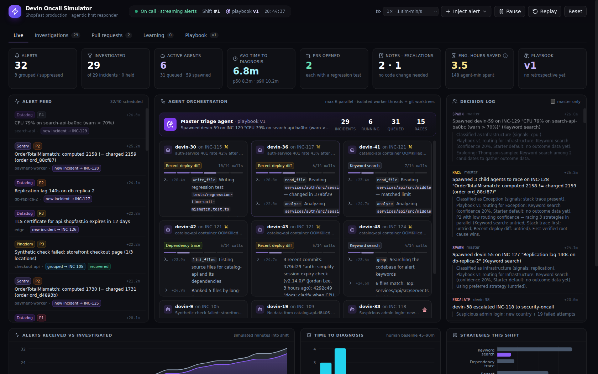
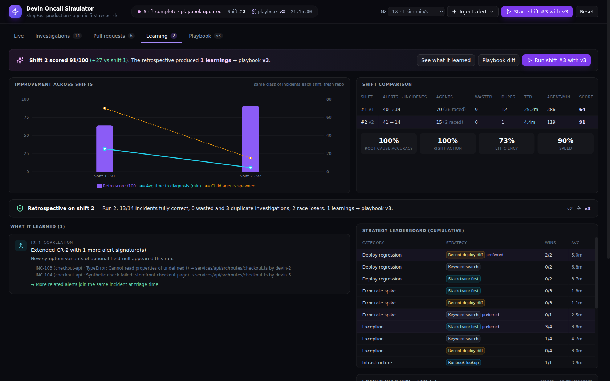

# Devin Oncall Simulator

A self-contained, offline demo of an **agentic on-call first responder**: a master triage agent watches a production alert stream, fans heavy investigations out to parallel child agents, opens real pull requests (with reproducing regression tests) against a mock codebase, and then **rewrites its own playbook** after every shift so the next shift is measurably better.

No API keys, no cloud services, no cost. Everything runs on your laptop.





---

## Run it

**Easiest (no terminal):** install [Node.js](https://nodejs.org) (LTS) and git once, download this repo, then double-click **`Start Demo.command`** (Mac) or **`Start Demo.bat`** (Windows) in the `oncall-simulator` folder. The first launch installs dependencies (about a minute); the dashboard then opens at http://localhost:4100. Close the window to stop. On a Mac, if it says the file can't be opened, right-click it → **Open** → **Open**.

**From a terminal:**

Requires Node.js 20.6+ and git.

```bash
cd oncall-simulator
npm install
npm run demo          # builds the dashboard and starts the engine
```

Open **http://localhost:4100** and press **Start shift**.

Other options:

| Command | What it does |
|---|---|
| `docker compose up --build` | Same thing in a container (port 4100) |
| `npm run dev` | Hot-reload mode (UI on :5173, engine on :4100) |
| `npm run headless -- 3` | Runs 3 shifts with no UI and prints how the score improves |
| `npm run reset` | Wipes all shifts and returns to the starter playbook (v1) — do this before a demo |

The **Reset** button in the dashboard does the same as `npm run reset`.

---

## The 5-minute demo script

| Time | Do | Say |
|---|---|---|
| 0:00 | Press **Reset**, then **Start shift**. | "This is a production on-call shift at a fictional e-commerce company. Alerts come from Datadog, Sentry, Pingdom, PagerDuty, even Zendesk — and most of them are noise." |
| 0:30 | Point at the **Alert feed** and the **Agent orchestration** panel. | "The master agent triages every alert: de-duplicates, groups, decides how deep to go. For heavy work it spins up child agents — each in its own isolated worker and git worktree, like a separate Devin." |
| 1:00 | Click a child card with the ⚔ icon. | "When the master isn't sure which approach will work, it **races** several strategies in parallel. First to a verified root cause wins; the others are cancelled." |
| 1:30 | Open **Pull requests** → a PR → *Checks* and *Files changed*. | "It never ships a guess. It writes a regression test, watches it fail, applies the fix, runs the whole suite, then opens the PR. A human still approves the merge." Click **Approve & merge** — the matching alerts stop firing. |
| 2:15 | Click a security or replication-lag incident. | "It knows when *not* to act: security goes to a human with context (a locked guardrail); infra issues get a note with the runbook steps instead of a code change." |
| 2:45 | Point at the KPIs and the hours-saved ⓘ tooltip. | "Time to diagnosis in minutes instead of the usual 45–90, and engineer hours saved with a formula you can defend." |
| 3:15 | When the shift ends, the **retrospective banner** appears → **See what it learned**. | "Now the part that compounds: it grades every decision it made and rewrites its playbook — noise rules, correlations, which strategy works for which kind of alert, and knowledge about this codebase. Every change carries evidence and a safety check." |
| 4:00 | **Playbook → Diff vs v1**, then **Run shift #2**. | "Same kinds of incidents next week. Watch: noise is held or suppressed, related alerts arrive pre-grouped, no more races, fewer agents, faster answers." |
| 4:45 | **Learning** tab chart. | "Score went from ~60 to ~90, agents spawned dropped by ~75%, time-to-diagnosis dropped ~5x. That's the ROI story: it gets better at *your* systems every week." |

Tip: the speed selector in the header (default 1 sim-minute per second) can compress or slow the shift. Shift 1 takes about 90 seconds at default speed; shift 2 about 50.

---

## What's actually happening (no smoke and mirrors)

```
 alert feed ──▶ master triage agent ──fan out──▶ child agent (worker thread + git worktree) ─┐
   (40 alerts,     • fingerprint/dedup                • reads shared scratchpad                 │
    noise +        • correlation rules                • strategy: stack trace / deploy diff /   │
    real bugs)     • noise hold/suppress rules          dependency trace / runbook / grep       ├─▶ PR / note / escalation
                   • classify + route strategy        • greps & reads the real mock repo        │
                   • race strategies when unsure      • reproduces with a failing test, fixes,  │
                   • arbitrates file claims             runs the suite, commits, opens PR ──────┘
                          │
                          ▼  end of shift
                   retrospective ──▶ playbook v(N+1).md  ──▶ loaded by the next shift
```

* **Mock codebase** (`mock-repo/`, copied to `data/workspace/shopfast` each shift): a small TypeScript monorepo — checkout API, auth service, payment worker, catalog service, shared db/money libraries — with real git history (including the "v2.14.0" deploy that introduced a bug), a service catalog, runbooks and a test suite. Six planted bugs: connection-pool leak, guest-checkout null dereference, retrying non-retryable 4xx errors, seconds-vs-milliseconds session expiry, unbounded in-memory cache, and cent-rounding in tax.
* **Alert feed** (`server/engine/scenario.ts`): ~40 alerts per shift across 21 alert types — real defects, investigation-only issues (Stripe outage, disk, TLS, replication lag), a security event, and noise (flapping synthetic checks, staging, autoscaler "no data", CPU warnings, duplicates from many hosts). Each shift re-randomizes hosts, numbers and timing. Start/pause, replay and inject (from a menu or a custom alert form) are all in the header.
* **Master agent** (`server/engine/master.ts`): applies playbook rules, groups alerts into incidents, classifies them, picks a strategy (preferred route, Thompson-sampling exploration, or a parallel race), writes every decision and its reasoning to the decision log and `data/runs/run-N/decisions.log`.
* **Child agents** (`server/engine/child/`): each runs in its own `worker_thread`. They genuinely grep and read the repo, parse stack traces, read `git log`/`git show`, run static bug-pattern detectors, and coordinate through a **shared scratchpad** (findings, incidental bugs, file claims, race results). If a sibling already claimed the root-cause file, they link their incident to that PR instead of opening a duplicate. Fixes happen in an isolated `git worktree`; the regression test must fail before and pass after, and the full suite must pass.
* **Self-improving loop** (`server/engine/retro.ts`): after a shift, every incident is graded (right root cause? right action? wasted effort? duplicate? how fast?) into a 0–100 score. Then the playbook is rewritten:
  * **De-duplication** — normalize host IDs and numbers when the same alert opened many incidents.
  * **Correlation rules** — learned from the agents' own findings: alerts on different services that were traced to the same root cause are grouped next time.
  * **Noise rules** — candidate rules are generated from wasted investigations and only accepted if they match zero real incidents (guardrail G5). Self-healing monitors get a *hold* rule (wait 5 minutes, investigate only if still firing) rather than being silenced — shift 2 includes a real outage on the same monitor to prove it.
  * **Strategy routing** — a bandit over outcomes per alert category (wins, minutes). Races stop once confidence is high.
  * **Knowledge** — verified fixes become "seen this before → look here first" hints.
  * **Safety revert** — any rule that suppressed a real incident is removed.
  * Each version is saved as `data/playbook/vN.md` + `.json` with a changelog; the dashboard shows the diff between versions.
* **Honesty notes for Q&A**: reasoning is deterministic heuristics, not an LLM, so the demo is reliable and free. The *orchestration pattern* (parent/child fan-out, isolated workspaces, scratchpad coordination, verified PRs, human-approved merges, evidence-based playbook updates) is the real thing. Simulated minutes model how long each tool call would take a real agent. The grader uses the scenario's hidden ground truth as a stand-in for on-call feedback (e.g. a human marking an alert as noise); the agents never see it.

## Engineer-hours formula

Shown in the dashboard tooltip. Conservative and net of human review time:

| Outcome | Minutes saved |
|---|---|
| Fix shipped as a tested PR | 75 (≈90 to page in, find, fix, test − 15 to review) |
| Diagnostic note, no code change needed | 40 (≈45 to investigate − 5 to read) |
| Escalation with pre-triaged context | 20 |
| Duplicate / noise alert filtered, grouped or self-recovered | 5 |

## What to highlight in a sales conversation

* **Mean time to diagnosis** — minutes, not the 45–90 an engineer needs to page in, gather context and find the cause. Every PR comes with a reproducing test, so reviewers trust it.
* **Noise is the hidden tax** — most pages don't need action. The agent filters them, and the filtering *improves on its own* with evidence, without silencing real outages.
* **Parallelism** — one engineer works one alert at a time; the agent works many, and races approaches when unsure.
* **It knows its limits** — guardrails for security and infra, escalation with context when it can't find the cause, humans approve every merge.
* **Compounding value** — the playbook is a versioned, reviewable artifact. Week over week, the agent gets better at *your* systems (Devin's Knowledge and Playbooks work the same way).

## Project layout

```
oncall-simulator/
  mock-repo/            the ShopFast codebase agents investigate (planted bugs, runbooks, tests)
  server/
    index.ts            HTTP API + static dashboard (port 4100)
    headless.ts         run shifts without the UI
    engine/
      engine.ts         shift lifecycle, feed, controls, persistence
      scenario.ts       alert templates + hidden ground truth
      master.ts         master triage agent
      child/            child agent (worker thread): strategies, tools, fix + PR flow
      detectors.ts      bug-pattern detectors, fixes, regression tests
      retro.ts          grading + playbook rewriting
      playbook.ts       starter playbook, markdown rendering, versions
  shared/               types shared by engine and dashboard
  web/                  React + Tailwind + Recharts dashboard
  data/                 runtime state (git-ignored): repo copy, worktrees, playbooks, logs
```
